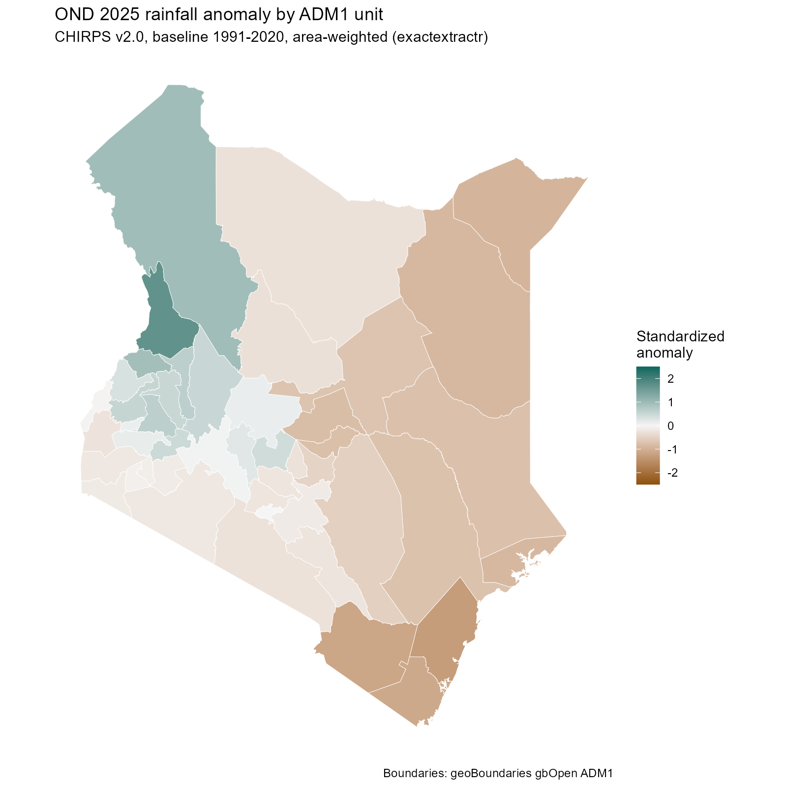

# Sub-national rainfall anomalies for East Africa (R)



An R pipeline that turns CHIRPS v2.0 monthly rainfall into seasonal anomaly indicators for each administrative unit (ADM1). The outputs are the kind of analysis-ready indicators used in drought early warning and anticipatory action.

**Stack:** `terra` for raster processing, `sf` for vector data, `exactextractr` for area-weighted zonal statistics, and `ggplot2` for the map.

## What it produces

For a target season (default: OND 2025 short rains, compared with a 1991–2020 baseline), it produces these indicators for each county or region:

| Column | Meaning |
|---|---|
| `rain_mm` | Seasonal rainfall total |
| `normal_mm` | Baseline mean for the same season |
| `anom_mm` | Difference from normal (mm) |
| `pct_normal` | Rainfall as a percentage of normal |
| `std_anom` | Standardized anomaly: (rain − mean) / sd, computed per pixel and then averaged over the unit |
| `dry_frac` | Share of the unit's area where the standardized anomaly is below −1 |
| `anomaly_class` | Category label, from "Very dry" to "Very wet" |

The outputs are:

- a tidy CSV of these indicators,
- a QA summary CSV (unit coverage, baseline completeness, value range checks),
- a GeoPackage for use in GIS or dashboards,
- a choropleth map.

## Run

```r
source("chirps_county_anomalies.R")
```

You can change the settings in the `config` list at the top of the script:

- `countries` sets which countries to run, e.g. `c("KEN","SOM","ETH","SSD","UGA","TZA")`.
- `season_months` sets the season, e.g. `3:5` for the MAM long rains.
- `target_year` and `baseline_years` set the season being assessed and the comparison period.

The first run downloads about 93 monthly files (roughly 30 baseline seasons × 3 months, plus the target season) and caches them in `data/`. Later runs reuse the cache.

## Method notes

- **Area weighting:** `exactextractr` weights each pixel by the fraction of it that falls inside the polygon. This matters at CHIRPS's 0.05° resolution (about 5.5 km), where small counties such as Mombasa or Nairobi cover only a few pixels.
- **Nodata handling:** CHIRPS nodata values (−9999) are set to NA before summing. A season with any missing month is treated as missing rather than undercounted.
- **Limits of the standardized anomaly:** rainfall is skewed, so a z-score is only an approximation. A proper SPI would fit a gamma distribution to the baseline. This is a straightforward extension (for example with the `SPEI` package, or by fitting the gamma per pixel with `terra::app`).
- **Boundaries:** ADM1 boundaries come from the geoBoundaries gbOpen API. Official national boundaries could be used instead.

## Data sources

- Funk et al. (2015), *The climate hazards infrared precipitation with stations*, Scientific Data. CHIRPS v2.0, Climate Hazards Center, UC Santa Barbara.
- Runfola et al. (2020), *geoBoundaries*, PLOS ONE.
